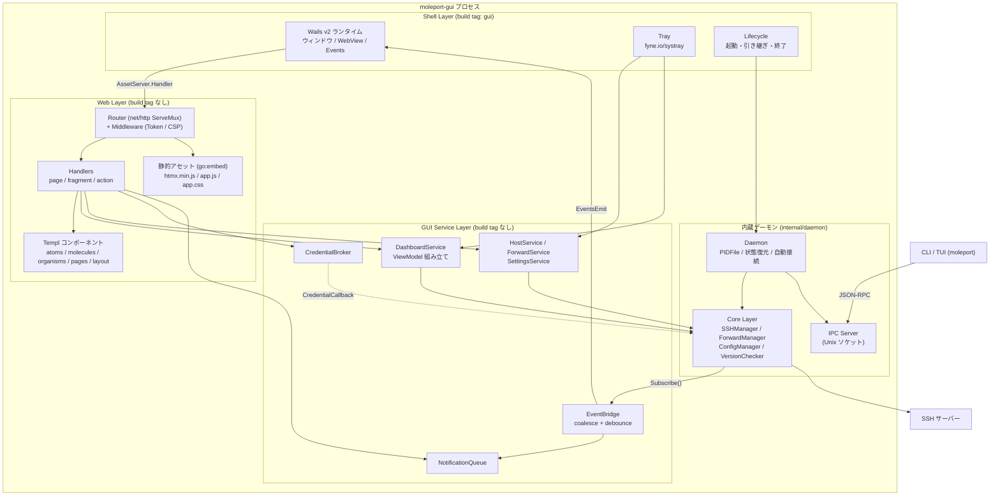
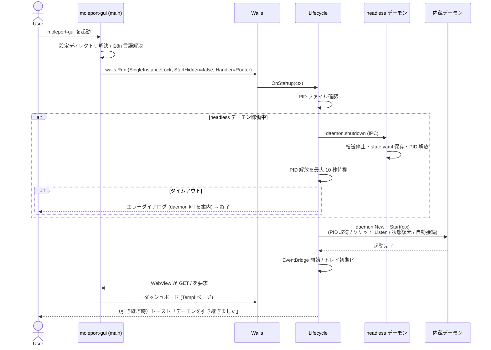
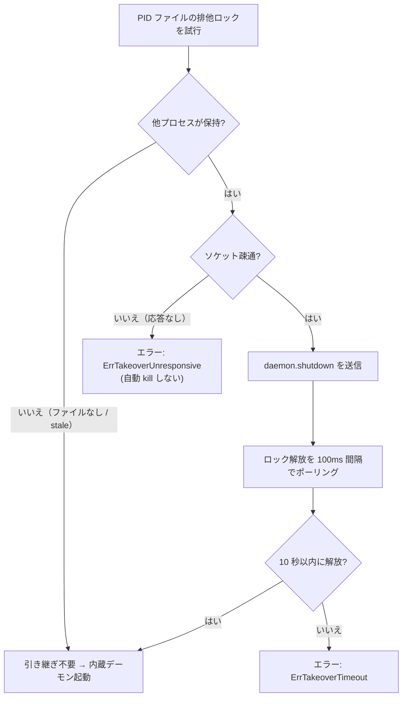
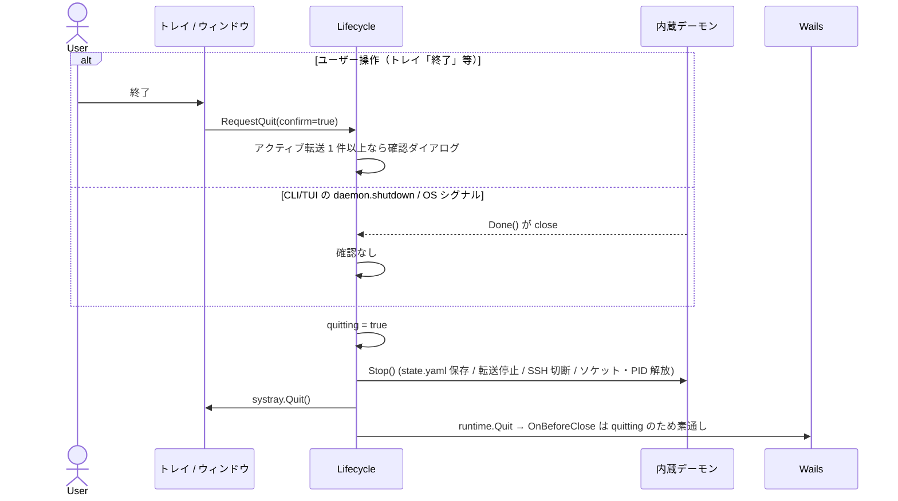
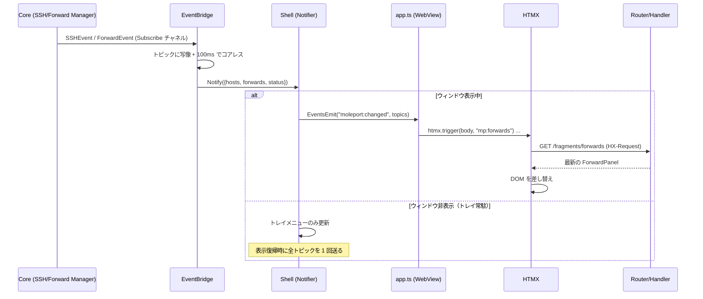
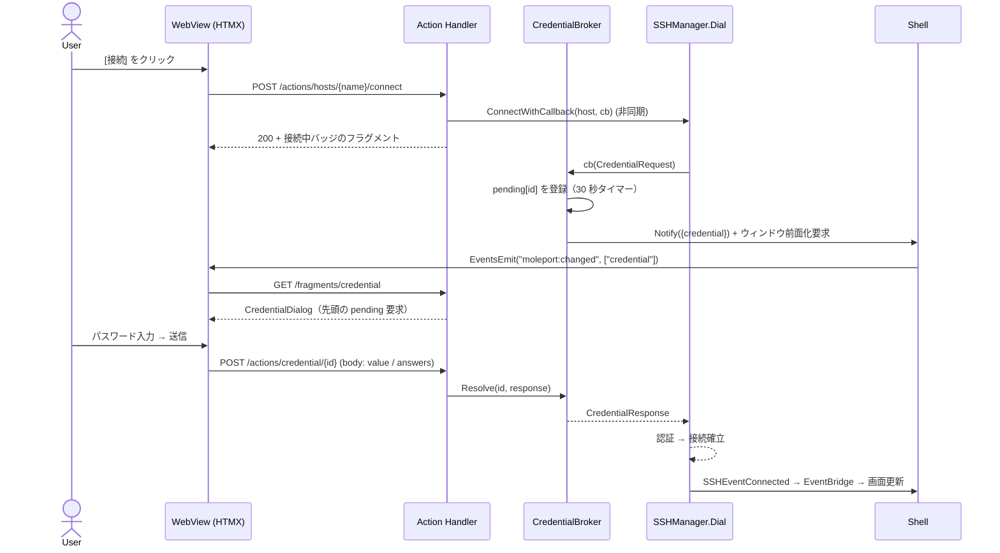
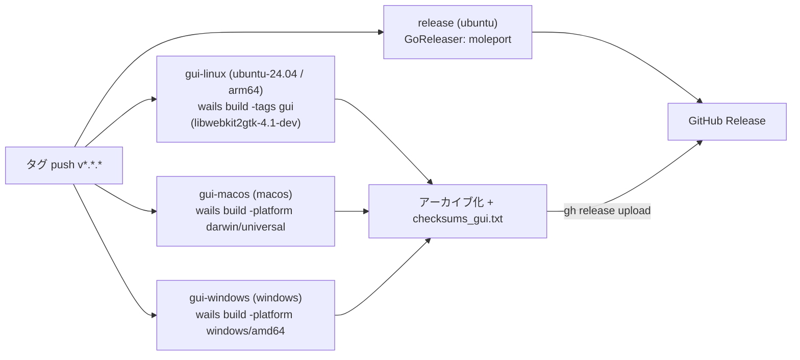

# MolePort GUI アーキテクチャ設計

## 概要

デスクトップ GUI `moleport-gui` は、Wails v2 の WebView に HALT 構成（HTMX + Atomic Design + Lit + Templ）のフロントエンドを表示し、**Core Layer と IPC サーバーを同一プロセスに内蔵**する。ウィンドウを閉じてもシステムトレイに常駐し、内蔵デーモンとして SSH 接続・ポートフォワーディングを維持する。

既存の headless 構成（`moleport` の デーモン + CLI/TUI。[architecture/overview.md](overview.md)）は変更せず共存する。GUI は「デーモンのもう 1 つの実装ホスト」であり、IPC プロトコル・PID ファイル・ソケット・設定ファイルを headless デーモンと共有するため、CLI/TUI から見たデーモンの振る舞いは変わらない。

## 設計判断

| # | 判断 | 採用 | 理由 / 却下案 |
|---|------|------|--------------|
| D-1 | デーモンとの関係 | GUI プロセスが内蔵デーモンを兼ねる（IPC を経由しない） | Core を直接呼ぶため GUI 内に IPC クライアントを持たずに済む。却下: GUI を IPC クライアント化（fork + ソケット往復が増え、クレデンシャル通知も IPC 化が必要） |
| D-2 | 常駐方式 | ウィンドウ非表示 + トレイ。プロセスは生存し続ける | ユーザー要望「バックタスクで動く」。GUI 終了 = デーモン終了（NFR-38 の引き継ぎ設計とセット） |
| D-3 | headless デーモンとの競合 | 起動時に `daemon.shutdown` で引き継ぐ（確認なし） | ユーザー決定。強制終了はしない（NFR-38） |
| D-4 | フロントエンド | HALT（net/http + Templ + HTMX + Tailwind + esbuild）。Gin / Huma は不採用 | 外部公開 API を持たないためフレームワークは過剰。Wails の `AssetServer.Handler` に `http.Handler` を直接渡せる |
| D-5 | Go ↔ JS の連携 | Wails の `Bind`（自動生成バインディング）は使わず、HTTP（AssetServer）+ Wails Events のみ | サーバー（Go）が UI を制御する HALT 原則。`wailsjs` 生成物と TypeScript 型の二重管理を避ける |
| D-6 | リアルタイム更新 | Go が `EventsEmit` → 薄い JS が `htmx.trigger` → HTMX が該当フラグメントを再取得 | Wails v2 の AssetServer は WebSocket 非対応、レスポンスストリーミングも Windows 非対応（SSE 不可） |
| D-7 | トレイ | `fyne.io/systray`（`RunWithExternalLoop`）を Wails と併用 | Wails v2 はトレイ非対応（メンテナー表明）。Linux は D-Bus 実装で GTK 非依存、Windows は Win32、macOS は Cocoa。Wails との併用は公式サポート外のため M2 の PoC で検証（「リスクと PoC」） |
| D-8 | ビルド分離 | Wails・トレイ依存は `gui` ビルドタグ配下 | CGO / WebKitGTK 無しの CI・既存 `go build ./...` を壊さない（NFR-41） |
| D-9 | 配布 | OS 別ネイティブランナーで `wails build`、GitHub Release に GUI アセットを追加 | Wails は CGO + OS ネイティブ WebView 必須。GoReleaser のクロスビルド対象外（NFR-40） |
| D-10 | Lit | 初期リリースでは Lit コンポーネントを実装しない | HALT の使用基準（リアルタイム編集・複雑 DnD・Canvas・WebSocket 同期）に該当する画面がない。ネイティブ `<dialog>` と HTMX で要件を満たせる。Lit 用のビルド枠（esbuild の複数エントリ、`static/src/components/`）は用意し、必要になった時点で追加する |

## 全体構成



## レイヤーと依存ルール

依存は上から下への一方向のみ。逆方向の import は禁止する。

```
Shell (gui タグ) → Web → GUI Service → Core (internal/core)
                    └→ Templ コンポーネント
Shell (gui タグ) → daemon (Start / Stop / Services / Done / Takeover)
```

| レイヤー | パッケージ | ビルドタグ | 責務 | 依存してよいもの |
|---------|-----------|-----------|------|----------------|
| Shell | `cmd/moleport-gui`, `internal/gui/shell`, `internal/gui/tray` | `gui` | Wails 起動、ウィンドウ制御、トレイ、起動/引き継ぎ/終了の統括、Wails Events 送信 | Web, Service, daemon, Wails, systray |
| Web | `internal/gui/web`（`handler/`, `middleware/`, `view/{atoms,molecules,organisms,pages,layout}`, `static/`） | なし | HTTP ルーティング、Templ レンダリング、トークン・CSP、静的アセット配信 | Service, i18n, Templ |
| GUI Service | `internal/gui/service`（`bridge/`: EventBridge、`credential/`: CredentialBroker） | なし | ViewModel 生成、ホスト/転送/設定操作、クレデンシャル仲介、イベントのバッチ化、非同期通知キュー（`NotificationQueue`） | `internal/core`, `internal/i18n` |
| Core / Infra | 既存 | なし | 既存どおり | — |

- `internal/gui/web` と `internal/gui/service` は Wails・トレイに依存しない。`go test ./...` で Linux CI 上でテストできる（NFR-41）
- Shell は Wails 型を Web / Service に漏らさない。Wails Events への送信は `service.Notifier`（`Notify(topics []Topic)` を持つ小さな interface）を Shell が実装して注入する
- IPC Layer（`internal/ipc`）は Web / Service から参照しない。GUI は `Handler` を経由せず Core を直接呼ぶ

## プロセスモデルとデーモン内蔵

### `internal/daemon` の変更点

GUI から再利用するため、`Daemon` に次を追加する。fork 起動（`StartDaemonProcess`）は headless 用として残す。

| 追加 API | 内容 |
|----------|------|
| `Services() Services` | Core の参照を返す構造体: `Config core.ConfigManager`, `SSH core.SSHManager`, `Forward core.ForwardManager`, `Version *update.VersionChecker` |
| `Done() <-chan struct{}` | デーモンのコンテキスト終了を通知（`daemon.shutdown` IPC、`Shutdown()` 呼び出しで close）。GUI はこれを監視してアプリを終了する |
| `Info() Info` | バージョン、PID、起動時刻（ヘッダー表示用） |
| `Takeover(configDir string, timeout time.Duration) (prevPID int, err error)` | 稼働中の headless デーモンを `daemon.shutdown` で停止し PID ファイルの解放を待つ（後述） |
| `pidfile.IsLocked(pidPath string) (locked bool, pid int)`（`internal/daemon/pidfile`） | PID ファイルの排他ロックが他プロセスに保持されているかを非破壊で判定する（ロックを試行して即解放）。`kill(pid, 0)` による生存確認は PID 再利用で誤判定するため、引き継ぎ判定には使わない |

- GUI は `Daemon.Wait()`（シグナル待ち）を使わず、`Start(ctx)` → `Done()` 監視 → `Stop()` の順で制御する。OS シグナル（SIGTERM/SIGINT）は Shell が受けて Wails の終了フローに接続する
- `Daemon.Stop()` は冪等のため、トレイ「終了」・`daemon.shutdown`・OS シグナルが競合しても二重停止しない
- ファイルの共有ロジック: ハンドラ内の `saveForwardRulesToConfig`（フォワードルールの config.yaml 保存）は `core` 側の関数（`core.PersistForwardRules(cfg ConfigManager, fwd ForwardManager)`）に移し、IPC ハンドラと GUI Service の両方から使う。ルール保存の二重実装を避ける

### Windows 対応のための分離（GUI のみ Windows 対応）

CLI/TUI の Windows 対応は対象外だが、内蔵デーモンを Windows で動かすため `internal/daemon` と依存先が Windows でコンパイルできる必要がある。Unix 専用 API をビルドタグで分離する。

| 対象 | Unix（既存） | Windows（新規） |
|------|-------------|----------------|
| PID ファイルの排他ロック | `syscall.Flock`（`daemon/pidfile/pidfile_unix.go`） | `LockFileEx`（`daemon/pidfile/pidfile_windows.go`、`golang.org/x/sys/windows`。強制ロックのため PID 読み取りを妨げない末尾側 1 バイトをロック） |
| プロセス生存確認・強制終了 | `syscall.Kill(pid, 0)` / `SIGKILL` | `OpenProcess` + `GetExitCodeProcess` / `TerminateProcess` |
| デーモンの fork 起動（`fork.go`） | `Setsid` | 非対応（`ErrUnsupported`。GUI は fork しない） |
| ProxyCommand の起動・終了（`proxycommand`） | `sh -c` + `Setpgid`、`kill(-pgid)` | `cmd /C` + `CREATE_NEW_PROCESS_GROUP`、`TerminateProcess`（子孫を含めるため Job Object） |
| SSH agent 接続（`infra/auth.go`） | `SSH_AUTH_SOCK`（Unix ソケット） | 既定 `\\.\pipe\openssh-ssh-agent`（`github.com/Microsoft/go-winio`）。`SSH_AUTH_SOCK` が設定済みなら優先 |
| IPC ソケット | `net.Listen("unix")` + `Chmod 0600` | 同 API（Windows 10 1803+ の AF_UNIX）。`Chmod` はベストエフォート、アクセス制御はプロファイル配下の ACL |
| OS シグナル | `SIGTERM` / `SIGINT` | `os.Interrupt`（コンソールなしでは受信しない。Wails のウィンドウ終了・セッション終了イベントで代替） |
| 設定ディレクトリ | `~/.config/moleport` | `%USERPROFILE%\.config\moleport`（`~` 展開は既存の `infra.ExpandTilde` を使用） |

`SIGKILL` による `daemon kill` と fork 起動は headless（Unix）専用のまま。

## 起動シーケンス



- ウィンドウ表示（WebView 読み込み）は内蔵デーモン起動をブロックしない。`GET /` は内蔵デーモンの起動完了まで「起動中」スケルトン画面ではなく、`LifecycleState`（`starting` / `ready` / `failed`）に応じたステータスバナー付きページを返す。`ready` 遷移時に全トピックの更新イベントを送る（NFR-32）
- 内蔵デーモン起動失敗（`failed`）はエラーダイアログ（`runtime.MessageDialog`）を表示してプロセスを終了する
- `OnStartup` より前に Wails が `SingleInstanceLock` を判定するため、2 つ目のプロセスは引き継ぎ処理を行わない（UC-38）

### 引き継ぎ（Takeover）



- 判定は `flock` / `LockFileEx` の保持有無で行う。PID が再利用された stale PID ファイル（誰もロックしていない）は「引き継ぎ不要」となり、通常の起動（`Acquire()`）で上書きされる
- 「ロック保持中だがソケット疎通なし」は応答しない旧デーモンの可能性があるため、強制終了せずエラーにする（NFR-38）
- `daemon.shutdown` の `purge` は常に `false`（state.yaml を保持して復元に使う）

## 終了シーケンス



### ウィンドウ閉じる操作の扱い

`HideWindowOnClose` は使わず、`OnBeforeClose` で明示制御する（`quitting` フラグ・トレイ可否を参照できるため）。

| 状態 | 閉じるボタンの結果 |
|------|-------------------|
| `quitting == true` | 閉じる（終了処理中） |
| トレイ利用可能 | `runtime.WindowHide` して `prevent = true`（初回のみ OS 通知。UC-32） |
| トレイ利用不可 | 確認ダイアログ → 「はい」で `RequestQuit` |

トレイ利用可否は `systray` の登録完了コールバック（`onReady`）の到達と、Linux では StatusNotifierWatcher の存在で判定し、判定は起動時に 1 回行う（NFR-37）。トレイが後から消えた場合（Linux のパネル再起動等）の検知は行わない。

## フロントエンド（HALT）

### ルーティング

HALT の 3 パターンのうち、JSON API ルート（Huma）は初期リリースでは持たない。

| パターン | URL | メソッド | 返却 | 備考 |
|---------|-----|---------|------|------|
| ページ | `/` | GET | フルページ（layout + ダッシュボード） | WebView 起動時の 1 回のみ。画面遷移（`hx-boost` 等）は使わない |
| フラグメント | `/fragments/...` | GET | HTML 断片 | HTMX の差し替え対象。`HX-Request` ヘッダーなしの直接アクセスは 400 |
| アクション | `/actions/...` | POST / DELETE | 更新後フラグメント + OOB トースト | トークン必須（NFR-35） |
| 静的 | `/static/...` | GET | JS / CSS | `go:embed`。`Cache-Control: no-cache`（アプリ更新で一緒に入れ替わるためハッシュ付与はしない） |

> **全画面遷移を持たない理由**: Wails v2 は `/wails/ipc.js`・`/wails/runtime.js` を起動時の最初のドキュメントに注入する想定である（[想定]。R-2 で検証）。ドキュメント遷移を避けて単一ドキュメント上のフラグメント差し替えに統一すれば、ランタイム注入の挙動に依存せず Events がページ生存期間中ずっと有効になる。

ルートの詳細は [api/gui-routes.md](../api/gui-routes.md) を参照。

### レンダリングと HATEOAS

- すべての HTML は Templ で生成する（NFR-35: 自動エスケープ）
- **実行可能なアクションだけをレンダリングする**。例: 状態が `Active` の転送行は「停止」のみ、`Stopped` / `Error` の行は「開始」のみ、`Pending Auth` / `Disconnected` のホストは「接続」のみを描画する（UC-29, UC-30）。ボタンの `hx-post` URL はサーバーが生成する（クライアントに URL 規則を持たせない）
- アクションの可否は `service` の ViewModel が `Actions` フィールド（`CanStart`, `CanStop`, `CanDelete`, `CanConnect`, `CanDisconnect`）として計算し、Templ は条件分岐のみを行う
- 検証エラーはフォームを再レンダリングして `422` で返す（`hx-target-422` + response-targets 拡張）。業務エラーは OOB でトーストを返す
- 二重送信防止は `hx-disabled-elt="this"`、進行表示は `hx-indicator`（スケルトンスクリーンは使わない）

### Atomic Design

| 階層 | コンポーネント |
|------|---------------|
| atoms | `StatusBadge`、`PortLabel`、`Spinner`、`KeyHint`、`DataSize`、`Duration`、`Button`、`TextInput`、`Select`、`Toast`、`Icon` |
| molecules | `HostRow`、`ForwardRow`、`FormField`（ラベル + 入力 + エラー）、`ConfirmDialog`、`CredentialPrompt`、`ThemeSwatch` |
| organisms | `Header`、`HostPanel`、`ForwardPanel`、`StatusBar`、`ToastStack`、`ForwardForm`、`SettingsForm`、`CredentialDialog` |
| pages | `DashboardPage` |
| layout | `BaseLayout`（`<head>`、meta トークン、CSP、`ModalRoot`、`ToastStack`） |

Templ コンポーネントのインターフェース規約は HALT に従う（引数 3 個以下は直接パラメータ、それ以上は `Props` 構造体、バリエーションは型付き const、子要素は `children...`）。

### スタイリング

- Tailwind CSS（ユーティリティクラス）。テーマは CSS カスタムプロパティ（`--mp-bg` 等）で定義し、`<html data-theme="dark|light" data-accent="violet|blue|green|cyan|orange">` で切り替える
- `gui.theme.base = system` のときは `prefers-color-scheme` に追従する（CSS のみで実現。JS 不要）
- テーマ変更のプレビュー（UC-34）はスウォッチの `hx-get` でなく、薄い JS が `data-theme` / `data-accent` を即時書き換える（サーバー往復なし、保存時にサーバー確定）。サーバーは次回レンダリング時に保存値を `<html>` に出力する

### ビルド

| 項目 | 内容 |
|------|------|
| 場所 | `internal/gui/web/static/`（`src/`、`dist/`）、`package.json`、`esbuild.config.mjs`、`tailwind` 入力 CSS |
| 入力 | `src/app.ts`（Wails Events → `htmx.trigger` の橋渡し、トークンヘッダー付与、テーマプレビュー）、`src/css/app.css`、（将来）`src/components/*` |
| 出力 | `dist/js/app.js`、`dist/js/htmx.min.js`、`dist/css/app.css`（`go:embed all:dist`） |
| `dist/` の扱い | git 管理しない（`.gitkeep` のみコミット）。`make gui-assets` で生成。`go:embed` が空ディレクトリで失敗しないよう `.gitkeep` を置く。Web 層のテストは `fstest.MapFS` を注入して静的アセット実体に依存しない |
| Templ | `*_templ.go` はコミットする。CI で `templ generate` 後に差分がないことを検査する（NFR-41）。Linterly の行数制限（300 行/ファイル、2000 行/ディレクトリ）に掛かるため、`.linterlyignore` に `*_templ.go` を追加する（既存の `*.pb.go` / `*_generated.go` と同様の自動生成ファイル扱い） |
| `wails build` | `wails.json` の `frontend:build` に `make gui-assets` 相当を設定。Wails の `frontend` ディレクトリ規約・生成バインディングは使わない（Bind なし）。設定キーは PoC で確認する |

### JS の責務（`app.ts` の範囲）

HALT の原則（クライアント状態を持たない）に従い、JS は次の 4 点に限定する。

1. `window.runtime.EventsOn('moleport:changed', ...)` で受けたトピックを `htmx.trigger(document.body, 'mp:<topic>')` に変換する
2. `htmx:configRequest` で `X-MolePort-Token` を付与する（トークンは `<meta name="mp-token">` から取得）
3. `htmx:responseError` でネットワーク/5xx の汎用エラートーストを表示する
4. テーマのプレビュー（`data-theme` / `data-accent` の即時切り替え）

## リアルタイム更新



### EventBridge

- 内蔵デーモンの `SSHManager.Subscribe()` / `ForwardManager.Subscribe()` を購読する（Core は複数購読者に対応済み。バッファ 16 のため、ブリッジは受信ゴルーチンで即座にデキューし、重い処理を持ち込まない）
- イベントを次のトピックに写像する

| イベント | トピック |
|---------|---------|
| `SSHEvent`（全種別） | `hosts`、`status` |
| `ForwardEventStarted` / `Stopped` / `Error` / `Reconnecting` / `Restored` | `forwards`、`hosts`（アクティブ転送数）、`status` |
| （Core はメトリクス更新イベントを発行しない。下記「ティッカー」で代替） | — |
| 設定変更（言語・テーマ・update_check） | `settings`、`all` |
| 新バージョン検出 | `header` |
| クレデンシャル要求の発生・解決 | `credential` |
| `SSHEventError` / `ForwardEventError` / 引き継ぎ完了 / 新バージョン検出 | `NotificationQueue` に通知（種別・ローカライズ済みメッセージ）を積み、`toast` |

- 100ms のウィンドウで同一トピックをコアレスして 1 回の `EventsEmit` にまとめる（短時間に複数イベントが重なってもフラグメント再取得が 10 回/秒を超えない）
- **ティッカー**: Core は `ForwardEventMetricsUpdated` を発行しない（定義のみで未使用。IPC の `event.metrics` も未実装）ため、稼働時間・送受信量・CLI/TUI による `forward.add` / `forward.delete` の反映は EventBridge 内のティッカーで行う

| ティッカー | 周期 | 動作する条件 | 送るトピック |
|-----------|------|-------------|-------------|
| ライブ | 1 秒 | ウィンドウ表示中かつアクティブ転送 ≥ 1 | `forwards`、`status` |
| 照合（reconcile） | 5 秒 | 常時（非表示中も） | ルール数・状態のシグネチャ（`GetRules` / `GetAllSessions` の名前+状態の連結ハッシュ）が前回と異なるときのみ `forwards`、`hosts`、`status` を送り、トレイメニューも更新する |

- ウィンドウ非表示中は `EventsEmit` を送らない（NFR-33）。ウィンドウ表示（`OnDomReady` 後の表示・フォーカス復帰）時に `all` を 1 回送る。非表示中の抑止は emit ループが `Visible()`（Shell の `VisibilityNotifier`）を参照して行い、`Notifier.Notify` 自体を呼ばない（コアレスしたトピックは破棄し、復帰時の `all` で再同期する）
- 照合ティッカーは Core のメモリ上の状態を読むだけでありディスク・ネットワークアクセスを行わない
- 1 秒ごとのフラグメント差し替えでフォーカス・スクロールが失われないよう、操作可能要素（ボタン・入力）には安定した `id` を付与する（HTMX は差し替え前後で同一 `id` の要素へフォーカスを復元する）。モーダル表示中は背景パネルの差し替えのみとし、モーダル内の入力は差し替え対象にしない（`ModalRoot` はライブ更新の対象外）
- GUI 自身の操作（追加・開始・停止・削除）は、アクションルートのレスポンスに更新後フラグメントを含めて即時反映する（イベント待ちにしない）
- ペイロードにはトピック名のみ含める。データ・クレデンシャルは含めない（NFR-36）
- **受信ループの規律**: `Subscribe()` のチャネルはバッファ 16 で、満杯になると Core はイベントを破棄する（`event dropped`）。EventBridge の受信ゴルーチンは非表示中も含め常に全件を即座にデキューし、トピック集合への写像だけを行う。コアレス・非表示中の `EventsEmit` 抑止・フラグメント再生成はすべて受信ループの下流（emit 側）で行い、受信ループでは Wails 呼び出しや HTML 生成をしない。復帰時は `all` で全体を再取得するため、破棄・抑止されたイベントがあっても一覧は最終的に整合する

## クレデンシャルフロー

内蔵デーモンの認証コールバック（`core.CredentialCallback`）は GUI Service の `CredentialBroker` が実装する。IPC ハンドラの `buildCredentialCallback`（クライアントへ通知して応答を待つ）と同じ契約で、通知先が WebView に変わるだけである。



- 接続・転送開始アクションは認証待ちでブロックしないよう、ハンドラは非同期で Core を呼び、即座にフラグメントを返す（結果は EventBridge 経由で反映される。失敗は `Error` 状態とトーストで通知）
- アクション直後のレスポンス時点では Core がまだ `Connecting` / `Starting` に遷移していないため、Service は進行中の接続・開始を `Activity` に記録して ViewModel に重ねる（「接続中…」「開始中…」バッジと 409 判定に使う）。Core は転送開始の失敗でセッションを `Stopped` に戻すだけなので、直近の開始失敗も `Activity` に保持して `Error` 表示（`LastError`）にする（停止・削除・再開始で消える）
- `CredentialBroker` は `requestID` 単位の待機チャネルを保持し、`Resolve` / `Cancel` / 30 秒タイムアウト（`core.CredentialTimeout`）のいずれかで解放する。キャンセルは `core.ErrCredentialCancelled`、タイムアウトは `core.ErrCredentialTimeout` を返す
- 複数要求が同時に発生した場合は FIFO で 1 件ずつダイアログに表示する
- 入力値は `POST` ボディ（`application/x-www-form-urlencoded`）のみで受け渡し、URL・ログ・イベントに含めない。ハンドラはボディを文字列化せずバイト列のまま解析し、`Resolve` が Core へ渡した後にバッファをゼロ化する（NFR-36）
- ウィンドウ非表示時は Shell がウィンドウを前面表示してからダイアログを表示する（UC-31）。Broker は要求発生時に `WindowController.Show()` を呼ぶ
- クレデンシャルダイアログは `#modal-root` とは別の `#credential-root` に差し込み、先に開いているモーダル（転送追加フォーム等）の上に重ねて表示する（入力途中の値を失わない）
- トレイからの転送開始も同じ `CredentialBroker` を使う（UC-33）。`Callback()` を公開 API とする
- CLI/TUI（IPC 経由）の認証要求は従来の `buildCredentialCallback` が処理し、GUI には出ない

## システムトレイ

- ライブラリ: `fyne.io/systray`。`systray.RunWithExternalLoop` により Wails のイベントループと共存させる（`Run` は使わない）
- 初期化は Wails の `OnStartup`（ウィンドウ生成後）で行う
- アイコン: `assets/tray/{mac-template.png, tray.png, tray.ico}`（`go:embed`。macOS はテンプレート画像でダーク/ライト自動反転）。現在はプレースホルダー（単色の円）で、製品版アイコンはファイルの差し替えのみで置き換える
- トレイ利用可否は起動時に 1 回だけ判定する（`onReady` に 5 秒以内に到達 かつ Linux は StatusNotifierWatcher が存在）。実行中にトレイが消えた場合の検知は行わない。M2 の PoC メニューは「表示」「終了」のみ（UC-33 のフルメニューは M3）
- メニュー構成は UC-33。状態変化（イベント発生時）に 500ms デバウンスで `ResetMenu` を使わず既存項目の `SetTitle` / `Check` / `Show` / `Hide` で更新する。転送項目は最大 20 件のプールを使い回す
- 左クリック: ウィンドウ表示（`SetOnTapped`）。右クリック: メニュー
- 言語変更時はメニュー全項目のタイトルを再設定する
- Linux: StatusNotifierItem（D-Bus）。StatusNotifierWatcher が不在の環境ではトレイ利用不可として扱う（UC-25 代替フロー）

## 設定の拡張

`config.yaml` に GUI 用セクションを追加する（詳細は [data-model.md](data-model.md)）。

```yaml
gui:
  theme:
    base: system      # system | dark | light
    accent: violet    # violet | blue | green | cyan | orange
  tray_notice_shown: false
```

TUI のテーマ（`tui.theme`）は独立して保持する。GUI のテーマは TUI と共有しない（TUI は 2 値のベーステーマ、GUI は `system` を含む 3 値であり、ターミナルとウィンドウで好みが異なる想定のため）。

## セキュリティ設計

| 脅威 | 対策 |
|------|------|
| 他プロセス・ネットワークからの GUI 操作 | TCP/UDP を開かない（AssetServer はプロセス内）。IPC ソケットは `0600`（Windows は ACL）（NFR-34） |
| WebView に表示された外部由来の文字列による意図しない操作 | Templ 自動エスケープ、CSP、状態変更ルートの起動ごとランダムトークン（NFR-35） |
| クレデンシャルの漏洩 | POST ボディのみ、ログ・イベント・URL に含めない、解決後ゼロ化（NFR-36） |
| 旧デーモンの強制終了による接続断 | 強制終了せず `daemon.shutdown` のみ（NFR-38） |
| CSP と Wails ランタイム注入の衝突 | ランタイムは同一オリジン（`/wails/*`）から読み込まれる前提で `script-src 'self'`。衝突する場合は PoC で最小限の例外を決める |

トークンの扱い: `crypto/rand` 32 バイトを起動時に生成し、`GET /` の `<meta name="mp-token">` に埋め込む。`POST` / `DELETE` はヘッダー `X-MolePort-Token` を `subtle.ConstantTimeCompare` で照合し、不一致は `403`。

## ビルドと配布

### ビルドタグとコマンド

| 対象 | コマンド | 備考 |
|------|---------|------|
| 通常ビルド・テスト・lint | `go build ./...` / `go test ./...` / golangci-lint | `gui` タグなし。Wails・トレイを含まない |
| GUI 開発 | `make gui-dev`（`cd cmd/moleport-gui && wails dev -tags gui -skipbindings`） | templ watch + esbuild watch。`wails.json` は `cmd/moleport-gui/` に置く |
| GUI ビルド | `make gui-build`（`cd cmd/moleport-gui && wails build -tags gui -skipbindings`） | OS ごとのネイティブ環境が必要。`wails.json` の `frontend:build` が `make gui-assets` を実行する |
| アセット | `make gui-assets`（`templ generate` + `npm run build`） | |

### リリースワークフロー

既存の `release.yml`（GoReleaser による CLI アーカイブ）はそのまま維持し、GUI は別ジョブで同じタグに追加アップロードする。



- GUI ジョブは GoReleaser ジョブがリリースを作成した後に `gh release upload` で追加する（`needs: release`）
- バージョンは `-ldflags "-X github.com/ousiassllc/moleport/internal/version.Version=<tag>"` で埋め込む（CLI と同じ変数。`internal/version` パッケージに置き、CLI・`moleport-gui` の両方が参照する）
- CI（`ci.yml`）に GUI ビルド確認ジョブを追加する（Linux / macOS / Windows のマトリクスで `-tags gui` ビルド）。Linux ジョブは `libwebkit2gtk-4.1-dev` / `libgtk-3-dev` を導入する。テストは通常ジョブの `go test ./...` に含まれる（GUI タグなし部分）
- 初期リリースは未署名。README に macOS の「開発元を確認できません」警告（右クリック → 開く）と Windows SmartScreen 警告の回避手順を記載する

## リスクと PoC（M2 で検証）

Wails v2 とトレイの併用および AssetServer の挙動は公式にサポートされていない・文書化が不十分な箇所があるため、機能実装（M3）の前に PoC で次を検証し、結果をこのドキュメントに反映する。

PoC 用の最小実装は `cmd/moleport-gui`、`internal/gui/shell`、`internal/gui/tray`（`gui` タグ）にある。結果の記録は「実際に実行して確認できたもの」だけに限り、未確認の項目は**実機検証待ち**と明記する。

| # | 検証項目 | 失敗時の方針 |
|---|---------|-------------|
| R-1 | `fyne.io/systray.RunWithExternalLoop` と Wails v2 の併用（macOS: Cocoa、Windows: メッセージループ、Linux: D-Bus）でクラッシュ・フリーズ・ウィンドウ制御の不具合がない | トレイを OS 別に縮退（失敗した OS はトレイなし = 閉じる操作は終了確認）。それでも GUI 全体は成立する（NFR-37） |
| R-2 | `AssetServer.Handler` が返す `GET /` の HTML に Wails ランタイム（`/wails/runtime.js`）が注入されるか | 注入されない場合は `Assets`（`fs.FS`）に静的 `index.html` を置き、最小の起動ページから `GET /fragments/app` を HTMX で読み込む |
| R-3 | `POST` / `DELETE` とカスタムヘッダー（`X-MolePort-Token`）・リクエストボディが Linux（WebKitGTK）で欠落しない | 欠落する場合はトークンをフォームのフィールドに載せ、ヘッダー依存をなくす |
| R-4 | CSP（`script-src 'self'`）が Wails ランタイム注入と衝突しない | 衝突箇所のみ最小限の例外を追加する（nonce 方式を検討） |
| R-5 | `OnBeforeClose` で `prevent = true` を返してウィンドウを `WindowHide` する挙動が 3 OS で安定する。macOS の Dock 再クリックでの再表示可否 | 再表示手段はトレイ（またはメニュー）に限定する。Dock クリックでの再表示は保証しない |
| R-6 | `SingleInstanceLock` の挙動（Linux は D-Bus セッションバスに依存）。D-Bus がない環境では多重起動を PID ファイルのロック失敗で検出する | PID ファイルのロック取得失敗エラーダイアログで代替（UC-25 代替フロー） |
| R-7 | 非表示ウィンドウへの `EventsEmit` の挙動と、表示復帰時の再同期 | 非表示中は送信しない方針（NFR-33）のため影響は小さい。表示復帰で全トピックを送る |
| R-8 | `wails.json` で `frontend` ディレクトリ・ビルドコマンドを既存リポジトリ構成に合わせられる | 合わせられない場合は Wails 既定の `frontend/` ディレクトリを使う |

### 縮退方針の実装状況

検証結果を待たずに、失敗時の縮退方針のうちコードで担保できるものは、`gui` タグに依存しない純粋ロジックとして実装し、ユニットテストしている。

| 縮退方針 | 実装 | テスト |
|---------|------|--------|
| トレイ利用可否（`onReady` 到達 + Linux の StatusNotifierWatcher）。5 秒以内に `onReady` へ到達しなければ利用不可（R-1, NFR-37） | `internal/gui/tray/availability.go`（`Available` / `Detect`）。Linux のホスト確認は `host_linux.go`、他 OS は不要（`host_other.go`） | `availability_test.go` |
| 閉じる操作の決定表（`quitting`・トレイ可否 → 素通し / `WindowHide` / 終了確認。トレイなしは必ず終了確認）（R-5, NFR-37） | `internal/gui/shell/close.go`（`DecideClose` / `CloseController`）、`dialog.go`（`IsAffirmative`） | `close_test.go`, `dialog_test.go` |
| 非表示中は `EventsEmit` しない。非表示 → 表示で `all` を 1 回送る（R-7, NFR-33） | `internal/gui/shell/notifier.go`（`VisibilityNotifier`） | `notifier_test.go` |
| 内蔵デーモン起動失敗（引き継ぎ失敗・PID ロック取得失敗を含む）はエラーダイアログ後に終了する。`SingleInstanceLock` が使えない環境でも PID ファイルのロックが二重起動を防ぐ（R-6） | `internal/gui/shell/lifecycle.go`（`Lifecycle.Start` / `StartupErrorKey`） | `lifecycle_test.go` |
| `daemon.shutdown`（IPC）・OS シグナル起因の終了は確認なし、トレイ「終了」はアクティブな転送があれば確認。`quitting` の二重実行を防ぐ | `internal/gui/shell/lifecycle.go`（`RequestQuit` / `Shutdown`） | `lifecycle_test.go` |

R-2（静的 `index.html` への切り替え）、R-3（トークンのフォームフィールド化）、R-4（CSP 例外）の縮退は、実機での検証結果が出てから該当する経路だけを実装する（現状は `GET /` を Router が返し、トークンはヘッダーで検証する）。

### 検証手順と結果

凡例: **確認済み** = 実際に実行して結果を得た / **実機検証待ち** = 必要な環境（ディスプレイ・各 OS の WebView・トレイ）がなく未実施。

共通の準備（実機）:

```bash
make gui-assets                                    # templ generate + npm run build（dist を生成）
cd cmd/moleport-gui && wails build -tags gui -skipbindings
# 生成物: cmd/moleport-gui/build/bin/moleport-gui(.exe / .app)
```

Linux は `libgtk-3-dev` と `libwebkit2gtk-4.1-dev` が必要で、`-tags gui,webkit2_41` を付ける。開発中の動作確認は `make gui-dev`。ログは stderr に出る（`moleport-gui 2>moleport-gui.log`）。

| # | 手順（コマンド・操作） | 確認観点 / 判定 | Linux | macOS | Windows |
|---|----------------------|----------------|-------|-------|---------|
| R-1 | `moleport-gui` を起動し、トレイアイコンが出ることを確認。ウィンドウの表示・移動・リサイズ・最小化を 1 分間操作し、トレイ「表示」「終了」を実行する。Linux は `busctl --user list \| grep StatusNotifierWatcher` で Watcher の有無を確認し、ある環境とない環境の両方で起動する | クラッシュ・フリーズ・ウィンドウ制御不能がない。Watcher なしの Linux で閉じるボタンが終了確認になる（`Detect` が `false`）。判定: 全項目 OK なら採用、1 つでも NG ならその OS はトレイなしに縮退 | 実機検証待ち | 実機検証待ち | 実機検証待ち |
| R-2 | `wails dev` で WebView の開発者ツールを開き、`GET /` のレスポンス HTML に `/wails/runtime.js`・`/wails/ipc.js` の `<script>` が含まれるか、`window.runtime.EventsOn` が定義されているかを確認する | 含まれ `EventsOn` が使える → 採用。含まれない → `Assets` に静的 `index.html` を置く方式に切り替える | 実機検証待ち | 実機検証待ち | 実機検証待ち |
| R-3 | ダッシュボード上で `hx-post` / `hx-delete`（カスタムヘッダー `X-MolePort-Token` 付き、ボディあり）を実行し、Router のリクエストログ（`Logging`）で到達と 200 を確認する。ヘッダー欠落時は `Token` ミドルウェアが 403 を返す | ヘッダーとボディが欠落せず 403 にならない → 採用。欠落する → トークンをフォームフィールド（`_token`）に載せ替える | 実機検証待ち（WebKitGTK が主対象） | 実機検証待ち | 実機検証待ち |
| R-4 | WebView のコンソールで CSP 違反（`Refused to execute inline script` 等）が出ないことを確認する。`runtime.js` 注入と HTMX の動作を同時に見る | 違反なし → 採用。違反あり → 違反箇所のみ最小の例外（nonce）を追加 | 実機検証待ち | 実機検証待ち | 実機検証待ち |
| R-5 | ウィンドウの閉じるボタンを押す。(a) トレイあり: ウィンドウが消えトレイから再表示できる。(b) トレイなし（Linux で Watcher なし）: 終了確認ダイアログが出て、「はい」で終了、「いいえ」で継続する。(c) macOS: 非表示後に Dock アイコンをクリックして再表示されるか。(d) `QuestionDialog` の戻り値（ボタンのラベルか `Yes` か）を各 OS で記録する | (a)(b) が各 OS で安定する。(c) は結果を記録するだけで保証しない。(d) は `IsAffirmative` が受理する値であること（受理されなければ `dialog.go` を修正） | 実機検証待ち | 実機検証待ち | 実機検証待ち |
| R-6 | 1 つ目を起動したまま 2 つ目を起動し、1 つ目が前面化して 2 つ目が引き継ぎ処理をせず終了することを確認する。Linux は `DBUS_SESSION_BUS_ADDRESS=` を空にして 2 つ目を起動し、PID ロック取得失敗のエラーダイアログで終了することを確認する | 多重起動が成立しない。D-Bus なしでも PID ロックで検出される | 実機検証待ち | 実機検証待ち | 実機検証待ち |
| R-7 | ウィンドウを非表示にした状態で CLI から `moleport connect <host>` を実行して状態を変え、ウィンドウを再表示する。stderr に `EventsEmit` のエラー・パニックが出ないことと、再表示直後にダッシュボードが最新状態になる（`all` による再取得）ことを確認する | 非表示中に例外がなく、再表示後に再同期される | 実機検証待ち | 実機検証待ち | 実機検証待ち |
| R-8 | `cd cmd/moleport-gui && wails build -tags gui -skipbindings -nopackage`（Linux ホストでは `-platform windows/amd64` を付けてクロスコンパイル）で `frontend:build` が実行されバイナリが生成されることを確認する | 実行されバイナリが生成される → 採用 | 実機検証待ち（`libgtk-3-dev` / `libwebkit2gtk-4.1-dev` が必要） | 実機検証待ち | ビルドのみ **確認済み**（下記）。起動は実機検証待ち |

#### R-8 で確認できたこと（Wails CLI v2.16.0、Linux x86_64 ホスト、`-platform windows/amd64`）

- `wails build` は `wails.json` のあるディレクトリの Go パッケージをビルドする（`-main` のようなオプションはない）。リポジトリルートに `wails.json` を置くと main パッケージが見つからず失敗するため、`wails.json` は `cmd/moleport-gui/` に置く。`make gui-build` / `make gui-dev` は `cd cmd/moleport-gui` してから `wails` を実行する
- `frontend:dir` を `.`、`frontend:build` を `make -C ../.. gui-assets` とすることで、`frontend/` ディレクトリを作らずに既存のリポジトリ構成のままビルドフックが実行され（`dist/` が再生成された）、Windows 向けバイナリ `moleport-gui.exe` が生成された（`Compiling frontend: Done.` / `Compiling application: Done.`）
- `-skipbindings` を付けても `wailsjs/runtime`（ランタイムの JS ラッパー）は生成されるため、`wails.json` の `wailsjsdir` を `build/wailsjs`（`.gitignore` 対象）にしてソースツリーを汚さない。Bind は使わないため、アプリ用の生成コードは作られない
- 確認したのは**ビルドまで**で、生成したバイナリの起動は行っていない。Windows 実機がないため、R-1〜R-7 の Windows 欄は実機検証待ち
- ビルド成果物（`cmd/moleport-gui/build/`）は `.gitignore` 対象

#### この環境（headless Linux）で確認できた範囲

- タグなしの `go build ./...` / `go test ./...` / golangci-lint が通る。`gui` タグ配下にのみ Wails・systray 依存がある（D-8, NFR-41）
- `GOOS=windows CGO_ENABLED=0` で `gui` タグ配下（`shell/app.go`・`tray/tray.go`・`cmd/moleport-gui`）が型検査・コンパイルできる（実行は未確認）
- Linux の `-tags gui,desktop,production` ビルドは `gtk+-3.0` / `webkit2gtk` の pkg-config がなく失敗する（環境要因）。macOS 向けは cgo が必要なため未確認
- `wails build` は `-tags desktop,production` を自動付与する。Linux の `go build -tags gui`（`desktop` なし）は Wails のネイティブ部分を含まないため通るが、実際の GUI ビルドの確認にはならない。`gui` タグ配下の確認には `GOOS=windows CGO_ENABLED=0 go vet -tags gui ./cmd/moleport-gui ./internal/gui/...` と Windows クロスビルドを使う

## 改訂履歴

| 版 | 日付 | 変更内容 | 変更理由 |
|----|------|---------|---------|
| 1.0 | 2026-10-15 | 新規作成 | #84 Wails 版 GUI アプリケーション |
| 1.1 | 2026-10-15 | `*_templ.go` を `.linterlyignore` に追加する旨、EventBridge 受信ループの規律（常時全件デキュー、emit 側で抑止）を追記 | レビュー指摘対応 #84 |
| 1.2 | 2026-10-15 | `wails.json` を `cmd/moleport-gui/` に置く構成（`frontend:dir: .` / `-skipbindings`）、PoC の検証手順・縮退方針の実装状況・実機検証待ちの明記、トレイ・ビルドコマンドの記述を実装に合わせて更新 | #87 M2 Shell 層 + PoC |
| 1.3 | 2026-10-15 | EventBridge の非表示中の抑止方法、トーストの自動消去（成功・情報 5 秒 / エラーは手動）を `app.ts` が担うことを明記 | #88 M3-1 ダッシュボード |
| 1.4 | 2026-10-15 | クレデンシャルフローの実装反映: 接続アクションの応答を `200` に修正、`Activity`（進行中の接続・開始と直近の開始失敗の重ね合わせ）、`#credential-root`（他モーダルに重ねる）、Service のサブパッケージ（`bridge/` / `credential/`）を追記 | #89 M3-2 操作系 |
