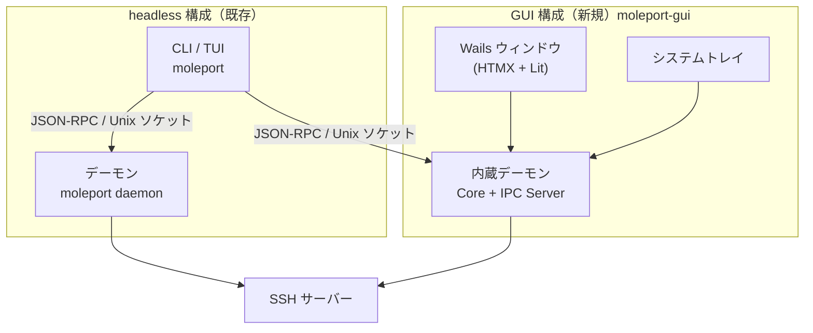

# MolePort プロジェクト概要

## 目的

SSH ポートフォワーディング（ローカル / リモート / ダイナミック）を `~/.ssh/config` ベースで一元管理し、接続の維持・自動再接続・状態の可視化までを 1 つのツールで提供する。
操作面として CLI・TUI に加え、デスクトップ GUI（Wails 版）を提供し、ターミナルに不慣れなユーザーでもトレイ常駐のまま転送を管理できる状態を目指す。

## 背景

- MolePort は Go 製のシングルバイナリ `moleport` として、バックグラウンドデーモン + CLI/TUI クライアント構成で提供されている（Linux / macOS）
- デーモンは Unix ドメインソケット上の JSON-RPC 2.0 で操作を受け付け、TUI を閉じても転送は継続する
- ターミナル操作を前提としない利用者向けに、ウィンドウとシステムトレイを備えたデスクトップアプリ版（`moleport-gui`）を追加する（Issue #84）
- GUI は Wails v2 + HALT（HTMX + Atomic Design + Lit + Templ）で構築し、Core Layer（SSHManager / ForwardManager / ConfigManager）を同一プロセスに内蔵する。ウィンドウを閉じてもトレイ常駐でデーモンとして動き続ける

## スコープ

### 含むもの

- SSH config 解析、ローカル/リモート/ダイナミック転送、自動再接続、セッション復元、設定永続化（既存）
- デーモン / CLI / TUI（既存。Linux・macOS）
- **Wails 版デスクトップ GUI `moleport-gui`**（Linux・macOS・Windows）
  - ホスト一覧・転送ルール一覧のリアルタイム表示、転送の追加・開始・停止・削除、SSH 接続・切断
  - クレデンシャル入力ダイアログ（パスワード / パスフレーズ / keyboard-interactive）
  - 言語・テーマ・アップデートチェックの設定
  - システムトレイ常駐、既存 headless デーモンの自動引き継ぎ、CLI/TUI との同時利用（IPC サーバー公開）
- GitHub Releases での GUI 配布（Linux / macOS は OS 別アーカイブ、Windows は NSIS インストーラー（ユーザー単位））

### 含まないもの

- GUI からのセルフアップデート（`moleport update` は CLI のみ。GUI は新バージョン通知とリリース URL 表示まで）
- Windows 向け CLI / TUI / headless デーモン（`moleport` バイナリは従来どおり Linux・macOS のみ）
- コード署名・公証（macOS notarization、Windows Authenticode）。初期リリースは未署名で配布する
- ProxyJump・IdentitiesOnly 等の SSH 互換拡張（F-54〜F-56 の「将来」項目）
- 転送ルールの編集機能（追加・削除のみ。既存 CLI/TUI と同じ）
- GUI のログイン時自動起動設定

## ステークホルダー / 想定ユーザー

| 区分 | 役割 | 備考 |
|------|------|------|
| ターミナル常用の開発者 | CLI / TUI で転送を管理 | 既存ユーザー。デーモンは GUI と共存可能 |
| GUI を好む開発者・運用者 | GUI で転送の設定・監視をトレイ常駐で行う | macOS / Windows / Linux デスクトップ |
| メンテナー | リリース・CI・ドキュメント管理 | OS 別ネイティブビルドが必要（CGO / WebView） |

## システム全体像

headless デーモンと GUI 内蔵デーモンは同じ PID ファイル・ソケットを使う排他関係にある（同時に稼働するのはどちらか一方）。詳細は [アーキテクチャ設計](architecture/overview.md) と [GUI アーキテクチャ](architecture/gui.md) を参照。

## ドキュメントマップ

このプロジェクトの仕様は以下のドキュメントで構成される。実装時はそれぞれ参照すること。

| ドキュメント | パス | 概要 |
|------------|------|------|
| 機能要件 | `docs/requirements/functional.md` | ユースケース（UC-1〜UC-38）と機能一覧（F-01〜F-56、GUI は F-57〜F-72）、CLI サブコマンド体系 |
| 非機能要件 | `docs/requirements/non-functional.md` | 性能・セキュリティ・可用性・運用性・コード品質要件（GUI は NFR-32〜NFR-41） |
| アーキテクチャ設計 | `docs/architecture/overview.md` | デーモン + クライアント構成、レイヤー構造、IPC 通信、i18n、GUI 構成の位置付け |
| GUI アーキテクチャ | `docs/architecture/gui.md` | Wails 内蔵デーモンのプロセスモデル、HALT フロントエンド、トレイ、引き継ぎ、Windows 対応、ビルド・リリース |
| データモデル | `docs/architecture/data-model.md` | config.yaml / state.yaml / PID・ソケット、内部モデル、IPC メッセージ型、GUI ビューモデル |
| IPC API 仕様 | `docs/api/ipc.md` | デーモンとクライアント間の JSON-RPC 2.0 メソッド・通知・エラー |
| GUI ルート仕様 | `docs/api/gui-routes.md` | Wails AssetServer が処理する HTTP ルート（ページ / フラグメント / アクション / Lit 用 JSON）と Wails イベント |
| コンポーネント設計 | `docs/components/overview.md` | 各レイヤーのコンポーネント責務・インターフェース、GUI Layer・プラットフォーム分離 |
| コマンド仕様 | `docs/commands/overview.md` | CLI コマンドの詳細仕様（既存） |

## マイルストーン / リリース計画

- M1: 基盤整備 — `internal/daemon` の Windows 対応（PID ロック・ProxyCommand・ssh-agent named pipe）とビルドタグ分離、`Daemon` の内蔵ホスト向け API（`Services()` / `Done()`）
- M2: GUI 骨格 — Wails + net/http ルーター + Templ レイアウト、静的アセット配信、Wails 組み込み PoC（ランタイム注入・トレイ併用の検証）
- M3: 機能実装 — ダッシュボード、転送操作、クレデンシャルダイアログ、設定画面、トレイ、引き継ぎ
- M4: 配布 — OS 別ビルドジョブ、Release への GUI アセット添付、ドキュメント・README 更新

具体的な時期は未定。

## 用語集

| 用語 | 定義 |
|------|------|
| デーモン | SSH 接続とポートフォワーディングを永続管理し、IPC サーバーを公開するプロセス |
| headless デーモン | `moleport daemon start` で起動する GUI を持たないデーモン |
| 内蔵デーモン | `moleport-gui` プロセス内で動作するデーモン。headless デーモンと同じ PID ファイル・ソケットを使う |
| 引き継ぎ（takeover） | GUI 起動時に稼働中の headless デーモンを停止し、内蔵デーモンが代わりに起動すること |
| トレイ常駐 | ウィンドウを閉じてもプロセスを終了せず、システムトレイのアイコンから操作できる状態 |
| HALT | HTMX + Atomic Design + Lit + Templ によるサーバー内蔵型フロントエンド構成 |
| AssetServer | Wails v2 が WebView からのリクエストを処理する仕組み。`http.Handler` を差し込める |
| フラグメント | HTMX が DOM 差し替えに使う部分 HTML |
| IPC | デーモンとクライアント間の JSON-RPC 2.0 通信（Unix ドメインソケット） |

## 改訂履歴

| 版 | 日付 | 変更内容 | 変更理由 |
|----|------|---------|---------|
| 1.0 | 2026-10-15 | 新規作成 | #84 Wails 版 GUI アプリケーション |
| 1.1 | 2026-10-15 | GUI 配布の Windows を zip から NSIS インストーラー（ユーザー単位）に変更 | Windows 配布形態の変更 #92 |
